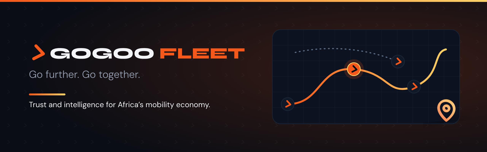

<a href="https://gogoofleet.com/?utm_source=github&utm_medium=org_profile">
  <picture>
    <source media="(prefers-color-scheme: dark)" srcset="https://raw.githubusercontent.com/Gogoo-Fleet/.github/main/profile/assets/banner-dark.png">
    <source media="(prefers-color-scheme: light)" srcset="https://raw.githubusercontent.com/Gogoo-Fleet/.github/main/profile/assets/banner-light.png">
    
  </picture>
</a>

<h3 align="center">The trust and intelligence layer for Africa's mobility economy</h3>

  <a href="https://developer.gogoofleet.com/?utm_source=github&utm_medium=org_profile">Developers</a>
  &nbsp;·&nbsp;
  <a href="https://gogoofleet.com/?utm_source=github&utm_medium=org_profile">Website</a>
  &nbsp;·&nbsp;
  <a href="https://gogoofleet.com/request-demo?utm_source=github&utm_medium=org_profile">Request a demo</a>
  &nbsp;·&nbsp;
  <a href="https://gogoofleet.com/company/careers?utm_source=github&utm_medium=org_profile">Careers</a>
  &nbsp;·&nbsp;
  <a href="https://www.linkedin.com/company/gogoo-fleet/">LinkedIn</a>

Every fleet owner asks the same three questions each day: can I trust my drivers, my vehicles and my numbers? GoGoo Fleet answers them. Trackers and day-to-day operations feed one live view of the fleet, and ZURI GO™ turns that view into what to do next.

## Start here

### Build on GoGoo

Everything our own apps do, your systems can do too. The developer portal gives you API keys tied to your organization, a sandbox to test against, webhooks, a full API reference and guides for bus, courier and ride-hailing operators.

**[Open the developer portal](https://developer.gogoofleet.com/?utm_source=github&utm_medium=org_profile)**

### Run a fleet

GoGoo Fleet OS is where owners and managers see vehicles, drivers, trips, documents, maintenance and money in one place. Already have trackers fitted? You can [connect them](https://gogoofleet.com/connect-your-tracker?utm_source=github&utm_medium=org_profile).

**[Request a demo](https://gogoofleet.com/request-demo?utm_source=github&utm_medium=org_profile)** &nbsp;·&nbsp; [Sign in](https://app.gogoofleet.com)

### Drive

GoGoo Driver puts inspections, fault reports, fuel logs, documents and reminders on the driver's phone.

**[Get it on Google Play](https://play.google.com/store/apps/details?id=com.gogoo.fleetapp)** &nbsp;·&nbsp; **[Download on the App Store](https://apps.apple.com/gh/app/gogoo-driver/id6761531425)**

## What we make

- **Live visibility.** Location, driver behaviour, vehicle health and compliance, from trackers and from the people doing the work.
- **ZURI GO™.** An assistant that reads the fleet's own data and answers in plain language, in the portal, in the driver app and on WhatsApp.
- **GoGoo Fleet OS.** The workspace that holds it together for owners, managers and finance teams.

---

  GoGoo Fleet &nbsp;·&nbsp; Accra, Ghana &nbsp;·&nbsp; <a href="mailto:hello@gogoofleet.com">hello@gogoofleet.com</a> 
  Go further. Go together.

